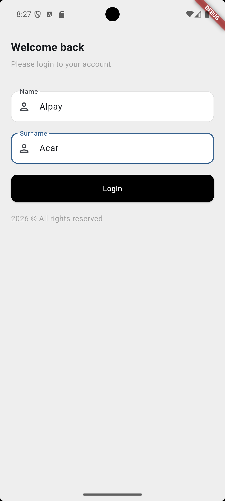
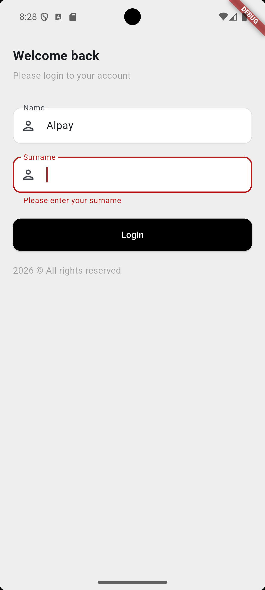
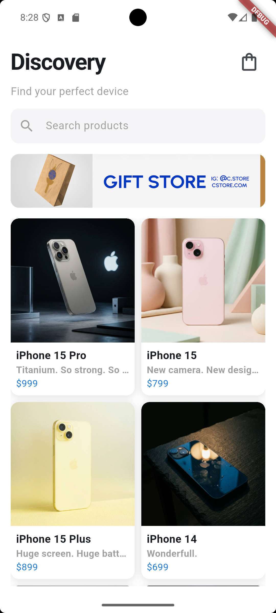
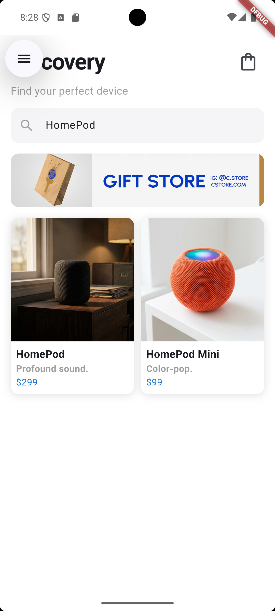
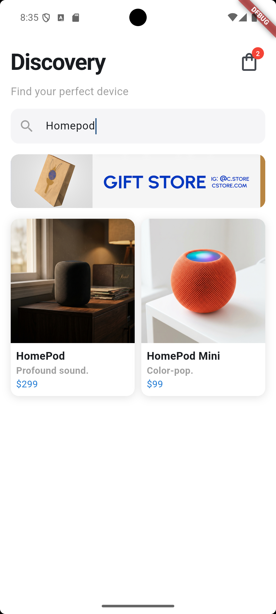
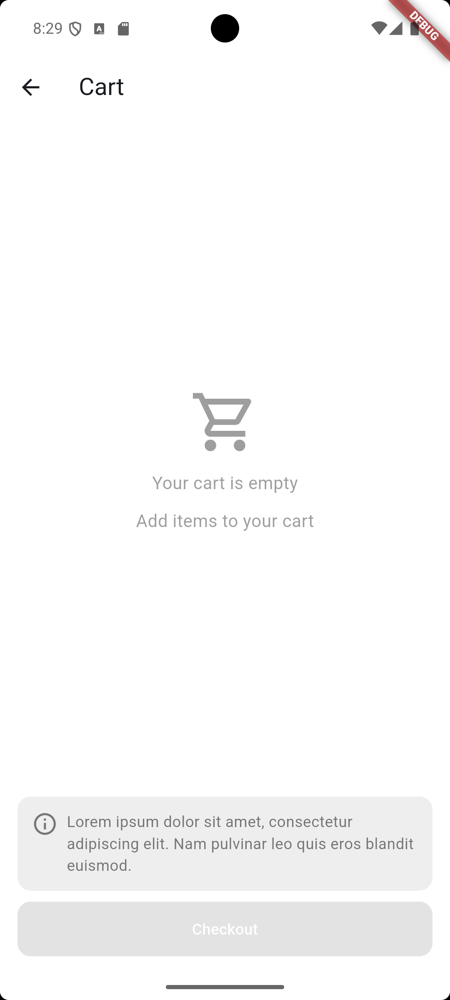
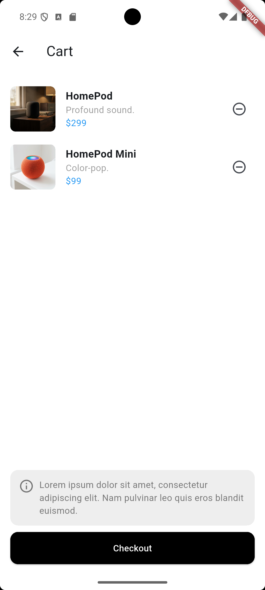
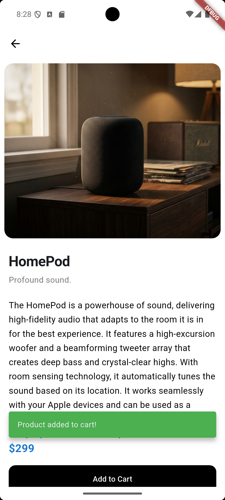
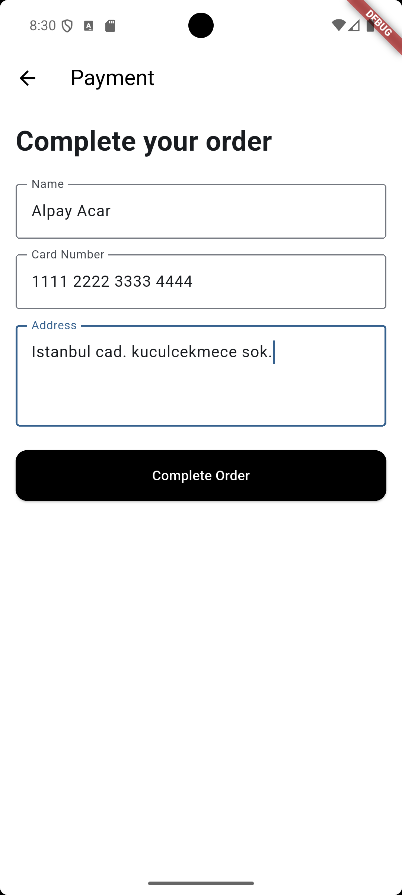
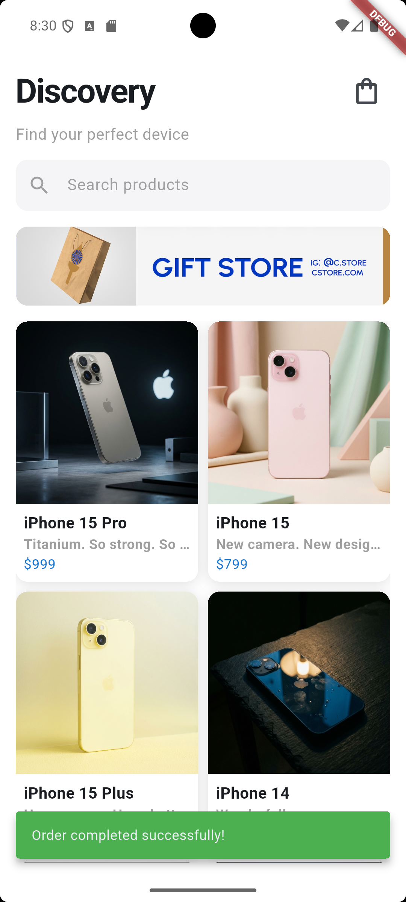

# Mini Katalog Uygulaması

## Proje Hakkında

Bu proje, Flutter mobil geliştirme eğitimi kapsamında geliştirilmiş temel seviyede bir mini katalog uygulamasıdır. Uygulama; ürün listeleme, ürün detay ekranı, sepet ekleme/silme, arama/filtreleme ve temel local storage kullanımını içerir.

## Özellikler

- Login ekranı
- Ürün listesi ve arama kutusu
- Ürün detay sayfası
- Sepet ekranı
- Sepet ikonunda ürün adedi rozeti
- Basit checkout akışı
- API verisi çekme
- Shared Preferences ile kullanıcı bilgisi saklama

## Kullanılan Teknolojiler

- Flutter SDK 3.13.5+
- Dart SDK 3.x
- http
- shared_preferences
- Material Design

## Kurulum ve Çalıştırma

1. Projeyi klonlayın:

```bash
git clone <REPOSITORY_URL>
cd mini_katalog
```

2. Bağımlılıkları yükleyin:

```bash
flutter pub get
```

3. Uygulamayı çalıştırın:

```bash
flutter run
```

## Ekran Görüntüleri

|                     Login                     |                    Hatalı Giriş                     |                  Ana Sayfa                   |
| :-------------------------------------------: | :-------------------------------------------------: | :------------------------------------------: |
|  |  |  |

|                Filtrelenmiş Ana Sayfa                 |                      Sepet Rozeti                       |                     Boş Sepet                      |
| :---------------------------------------------------: | :-----------------------------------------------------: | :------------------------------------------------: |
|  |  |  |

|                     Dolu Sepet                      |                       Ürün Detay                       |                     Checkout                     |
| :-------------------------------------------------: | :----------------------------------------------------: | :----------------------------------------------: |
|  |  |  |

|                     Sipariş Başarılı                     |
| :------------------------------------------------------: |
|  |

## Not

Bu proje eğitim/demo amaçlıdır. Gerçek ödeme sistemi veya üretim e-ticaret altyapısı içermez.
